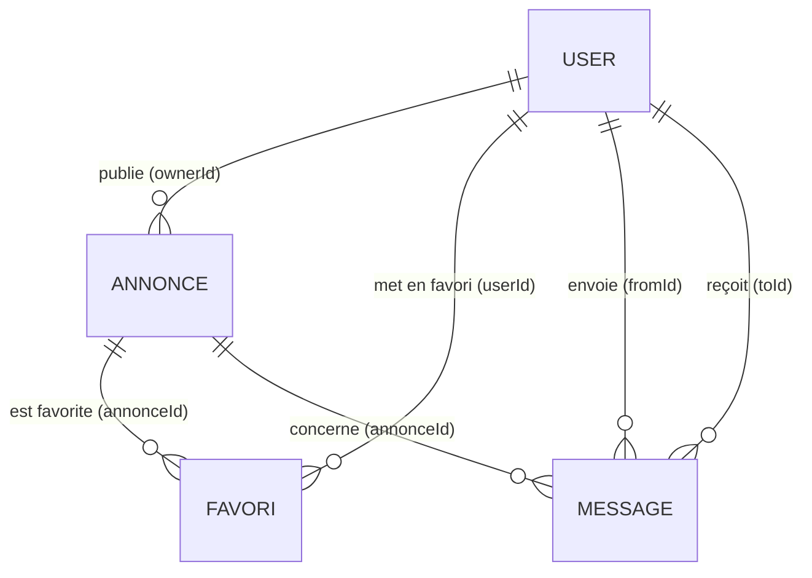

# Base de données MongoDB

LeBonDeal utilise **uniquement MongoDB** (via Mongoose). La base tourne dans un conteneur Docker, aucune installation locale de MongoDB n'est nécessaire.

## Démarrer la base

Prérequis : Docker avec le plugin Compose.

```bash
cp backend/.env.example backend/.env     # une seule fois, puis adapter les mots de passe
npm run db:up                            # démarre MongoDB et attend qu'il soit « healthy »
npm run db:seed                          # (facultatif) données de démonstration
```

| Commande | Effet |
| --- | --- |
| `npm run db:up` | Démarre le conteneur `lebondeal-mongo` (port 27017, **localhost uniquement**) |
| `npm run db:down` | Arrête le conteneur, **les données sont conservées** (volume `lebondeal_mongo-data`) |
| `npm run db:reset` | Arrête le conteneur **et supprime les données** ; le prochain `db:up` repart d'une base vierge |
| `npm run db:seed` | Recrée les données de démonstration (idempotent, refusé si `NODE_ENV=production`) |

Comptes de démonstration (fictifs) : `thomas.durand@example.test`, `claire.bernard@example.test`, `alexandre.martin@example.test`, `sarah.klein@example.test`, `demo@example.test`. Mot de passe commun : `MotDePasse123!`.

## Comptes et bases

Au premier démarrage, `docker/mongo/init/01-create-app-user.js` crée un utilisateur applicatif (`MONGO_APP_USER`) limité à `readWrite` sur deux bases :

| Base | Usage |
| --- | --- |
| `lebondeal` | Développement (utilisée par l'API et le seed) |
| `lebondeal_test` | Tests Jest/Supertest : vidée avant chaque test, **jamais** la base de dev |

Le compte `root` n'est utilisé que par Docker. L'API n'a aucun droit sur les autres bases (vérifié : une écriture sur une autre base est refusée avec `Unauthorized`).

Le script d'initialisation ne s'exécute qu'à la **création** du volume : après un changement de mot de passe dans `backend/.env`, lancer `npm run db:reset` puis `npm run db:up`.

## Variables d'environnement

Voir `backend/.env.example` (jamais de vrai secret dans Git).

| Variable | Rôle |
| --- | --- |
| `MONGO_PORT`, `MONGO_ROOT_USER`, `MONGO_ROOT_PASSWORD` | Conteneur MongoDB |
| `MONGO_APP_USER`, `MONGO_APP_PASSWORD`, `MONGO_APP_DB` | Utilisateur applicatif créé à l'initialisation |
| `MONGODB_URI` | Connexion de l'API à la base de développement |
| `MONGODB_URI_TEST` | Connexion des tests ; le nom de base **doit finir par `_test`**, sinon les tests refusent de démarrer |

## Schéma



### `users`

| Champ | Type | Règles |
| --- | --- | --- |
| `email` | String | obligatoire, **unique**, stocké en minuscules, trim, 254 max |
| `passwordHash` | String | obligatoire, hash **bcrypt**, `select: false` (jamais renvoyé par défaut) |
| `createdAt`, `updatedAt` | Date | automatiques |

Index : `email` unique. La comparaison est insensible à la casse car l'email est normalisé avant stockage.

### `annonces`

| Champ | Type | Règles |
| --- | --- | --- |
| `titre` | String | obligatoire, 1 à 120 caractères après trim |
| `description` | String | 0 à 2000 caractères, défaut `''` |
| `prix` | Number | obligatoire, **entier** de 0 à 1 000 000 (euros) |
| `categorie` | String | obligatoire : `Multimédia`, `Loisirs & Sport`, `Maison & Mobilier` |
| `etat` | String | `Neuf`, `Comme neuf`, `Très bon état` (défaut), `Bon état`, `État correct` |
| `statut` | String | `DISPONIBLE` (défaut), `RESERVEE`, `VENDUE` |
| `photo` | String \| null | URL http(s), 500 max |
| `ville` | String | obligatoire, 1 à 80 caractères |
| `codePostal` | String \| null | 5 chiffres |
| `ownerId` | ObjectId → `users` | obligatoire, **toujours posé côté serveur depuis le JWT** |

Index : `{ownerId, createdAt:-1}` (« Mes annonces »), `{createdAt:-1}` (catalogue), `{statut, createdAt:-1}` et `{categorie, prix}` (filtres).

La recherche par titre utilise une expression régulière insensible à la casse (avec échappement des caractères spéciaux) : suffisant à cette échelle, un index texte serait l'évolution naturelle.

### `favoris`

| Champ | Type | Règles |
| --- | --- | --- |
| `userId` | ObjectId → `users` | obligatoire |
| `annonceId` | ObjectId → `annonces` | obligatoire |

Index : `{userId, annonceId}` **unique** (un favori par utilisateur et par annonce), `{annonceId}` (nettoyage à la suppression d'une annonce).

### `messages`

| Champ | Type | Règles |
| --- | --- | --- |
| `annonceId` | ObjectId → `annonces` | obligatoire |
| `fromId` | ObjectId → `users` | obligatoire, = utilisateur du JWT |
| `toId` | ObjectId → `users` | obligatoire, = propriétaire de l'annonce |
| `body` | String | obligatoire, 1 à 1000 caractères après trim |

Index : `{toId, createdAt:-1}` (boîte de réception), `{annonceId}` (nettoyage).

## Intégrité des données

MongoDB n'a pas de clés étrangères : l'intégrité est assurée par l'application.

- Supprimer une annonce supprime ses favoris et ses messages (`annonceService.deleteAnnonce`).
- Les créations concurrentes sont départagées par les index uniques (email, favori) : l'erreur Mongo `11000` est traduite en `409 EMAIL_ALREADY_USED` ou ignorée (favori idempotent).
- Les index sont créés automatiquement par Mongoose au démarrage (`autoIndex`). Les tests attendent leur création (`Model.init()`).

## Inspecter la base

```bash
docker exec -it lebondeal-mongo mongosh -u lebondeal_app -p <MONGO_APP_PASSWORD> --authenticationDatabase admin lebondeal
> db.annonces.find({}, { titre: 1, prix: 1, statut: 1 })
> db.annonces.getIndexes()
```

## Sauvegarde et restauration (développement)

```bash
# sauvegarde
docker exec lebondeal-mongo mongodump -u lebondeal_app -p <MONGO_APP_PASSWORD> --authenticationDatabase admin --db lebondeal --archive > sauvegarde.archive
# restauration
docker exec -i lebondeal-mongo mongorestore -u lebondeal_app -p <MONGO_APP_PASSWORD> --authenticationDatabase admin --archive --drop < sauvegarde.archive
```

Ne commitez jamais une sauvegarde : elle contient des données utilisateurs.

## Limites connues

- Mongo est exposé sans TLS, uniquement sur `127.0.0.1` : adapté au développement, pas à une production publique.
- Pas de transaction : la suppression en cascade n'est pas atomique (une panne entre deux suppressions peut laisser un favori ou un message orphelin : un favori orphelin est invisible, un message orphelin s'affiche comme « annonce supprimée »).
- Pas de pagination par curseur : `page`/`limit` (100 maximum).
